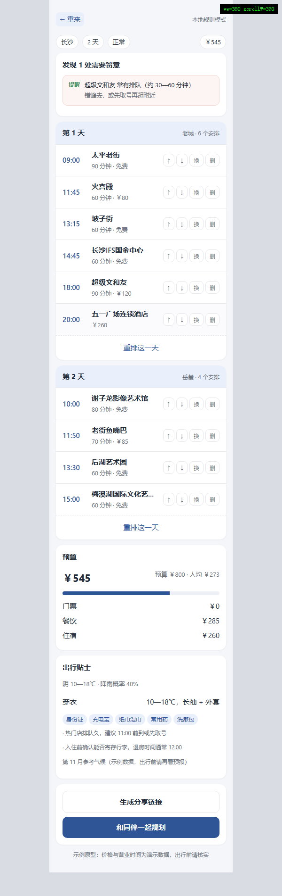
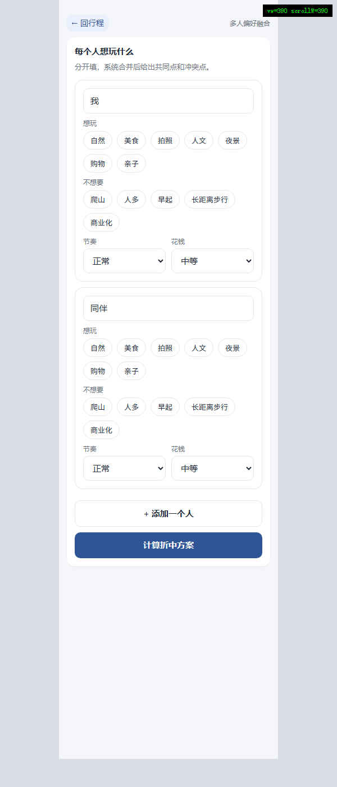

# 闲行智策 · 可运行雏形

一句话生成可编辑的短途行程：**说需求 → 确认 → 生成 → 改某一天 → 预算联动 → 结伴融合**。

- 不用 API Key 也能完整演示（本地规则模式）
- 配了模型 Key 自动切换成模型生成，失败自动降级
- 手机同 WiFi 可直接访问，现场演示不依赖外网

| 首页 | 行程页 | 结伴页 |
|---|---|---|
|  |  |  |

---

## 1. 怎么跑

```powershell
cd cxcy
python -m venv .venv
.venv\Scripts\activate
pip install -r requirements.txt
uvicorn server.main:app --reload --host 0.0.0.0 --port 8000
```

浏览器打开 <http://127.0.0.1:8000>；手机连同一个 WiFi，访问 `http://电脑IP:8000`。
接口文档在 <http://127.0.0.1:8000/docs>（答辩可直接展示）。

Windows 也可以双击 `run.bat`（首次会自动建虚拟环境装依赖）。

### 不想开命令行：双击就开

| 文件 | 作用 |
|---|---|
| `闲行智策.lnk` 或 `start.vbs` | 后台启动服务 + 自动打开浏览器（**不弹黑框**） |
| `stop.bat` | 停掉 8000 端口上的服务 |

- 想放到桌面/任务栏：把 `闲行智策.lnk` 拖过去即可。
- 想开机自动可用：`Win + R` 输入 `shell:startup`，把快捷方式放进打开的文件夹。
- 之后只需在浏览器书签点一下 <http://127.0.0.1:8000>。

**装不上 FastAPI 时**（比如没网）：用标准库预览服务器也能跑页面——

```powershell
python scripts\devserver.py 8010     # 打开 http://127.0.0.1:8010
```

安装慢就用国内镜像：

```powershell
.venv\Scripts\python.exe -m pip install -r requirements.txt -i https://pypi.tuna.tsinghua.edu.cn/simple
```

> `run.bat` 已处理两件事：优先用 Python 3.12 建环境；失败时提示镜像命令。
> 批处理是**纯 ASCII + CRLF**，避免 cmd 在中文系统下把 UTF-8 当 GBK 解析。

### 自检

```powershell
python scripts\smoke.py       # 解析 → 生成 → 校验 → 预算 → 贴士（不需要 FastAPI）
python scripts\check_api.py   # 用桩替换 FastAPI，逐个调用接口函数
python scripts\check_web.py   # 检查 JS 引用的元素 id 是否都存在
python scripts\live_check.py  # 对运行中的服务发真实 HTTP 请求（先启动 uvicorn）
```

---

## 2. 3 分钟演示路径

1. 首页输入：**“这周末去长沙两天，两个人，预算 800，不想爬山，想吃美食、拍照”**
2. 点「帮我理解需求」→ 出现确认卡（城市/天数/预算/人数/兴趣/避雷都能改）
3. 点「生成行程」→ 进入行程页
4. 删掉一个收费点 → 右上角预算立刻变小
5. 点某一天的「重排这一天」→ 只有这一天变，其他天不动
6. 点「换一个」→ 同类地点替换
7. 底部「和同伴一起规划」→ 两人分别勾选 → 计算 → 看到共同点与冲突 → 按方案 B 调整

---

## 3. 目录

```
cxcy/
├─ server/
│  ├─ main.py            FastAPI 路由 + 静态页
│  ├─ service.py         编排：建行程 / 改一项 / 重排 / 融合
│  ├─ db.py              SQLite 建表与读写
│  ├─ llm.py             模型调用（OpenAI 兼容，可降级）
│  ├─ config.py          路径、密钥、mock 开关
│  ├─ agents/
│  │  ├─ parse.py        ① 需求解析（规则 + 模型）
│  │  ├─ plan.py         ② 行程生成（候选白名单 + 按时长排）
│  │  ├─ validate.py     ③ 校验（时间/闭馆/营业时间/预算/避雷）
│  │  ├─ budget.py       ④ 预算（纯代码）
│  │  ├─ merge.py        ⑤ 多人偏好融合
│  │  └─ tips.py         ⑥ 出行贴士（天气 + 模板）
│  └─ seed/poi_changsha.csv   32 个长沙 POI（示例数据）
├─ web/                  三个页面 + 无框架 JS
├─ shots/                页面截图（README 引用）
├─ data/app.db           运行时生成（不进 Git）
└─ scripts/              smoke.py / check_api.py / check_web.py / devserver.py
```

自检：

```powershell
python scripts\smoke.py
```

---

## 4. 接口

| 方法 | 路径 | 作用 |
|---|---|---|
| GET | `/api/health` | 状态（mock / POI 数） |
| POST | `/api/parse` | 一句话 → 需求 JSON |
| POST | `/api/trips` | 需求 → 建行程 |
| GET | `/api/trips/{id}` | 行程全量（天/条目/预算/冲突/贴士） |
| PATCH | `/api/trips/{id}/items/{iid}` | 改时间、时长 |
| DELETE | `/api/trips/{id}/items/{iid}` | 删一条 |
| POST | `/api/trips/{id}/items/{iid}/swap` | 换一个同类 |
| POST | `/api/trips/{id}/items/{iid}/move` | 上移/下移 |
| POST | `/api/trips/{id}/days/{day}/regenerate` | 只重排这一天 |
| POST | `/api/trips/{id}/regenerate` | 全量重排（可带 avoid） |
| POST | `/api/trips/{id}/members` | 多人偏好融合 |
| POST | `/api/trips/{id}/share` | 生成分享链接 |

---

## 5. 六个智能体在哪、怎么换模型

| # | 文件 | 是否用模型 |
|---|---|---|
| ① 需求解析 | `agents/parse.py` | 有 Key 用模型，否则关键词规则 |
| ② 行程生成 | `agents/plan.py` | 同上；模型只能在候选 POI 里选 |
| ③ 校验 | `agents/validate.py` | **纯规则** |
| ④ 预算 | `agents/budget.py` | **纯代码** |
| ⑤ 偏好融合 | `agents/merge.py` | **算法**，模型只写解释（可选） |
| ⑥ 贴士 | `agents/tips.py` | 模板 + 天气 |

接模型：

```
# .env
LLM_BASE_URL=https://api.deepseek.com/v1
LLM_API_KEY=sk-xxx
LLM_MODEL=deepseek-chat
MOCK_MODE=auto
```

重启后 `/api/health` 的 `mock` 变 `false`；模型超时或报错会自动回落到本地规则，页面不会白屏。

---

## 6. 有意为之的取舍

- **不用 Vue/React**：现场演示与交接成本优先，原生 JS 改一行就能看效果。
- **校验不交给模型**：时间重叠、闭馆、营业时间、超预算必须确定，模型只负责解释。
- **生成只做一次**：一次调用出完整行程，避免"多智能体"变成"多轮等待"；校验与预算在保存后跑。
- **POI 是示例数据**：价格与营业时间为演示值，接真实数据前不能当决策依据。

## 7. 下一步（按优先级）

1. 把 `seed/poi_changsha.csv` 换成 3 个城市各 40 条真实 POI（标注更新时间）
2. 行程页接 SSE 流式生成（现在是一次性返回）
3. 接入天气接口替换 `tips.py` 里的示例气候
4. 上传行程图片（html2canvas 或后端截图）
5. 结伴的"应用方案 A/B"目前只做方案 B，A 需要拆分半天行程
