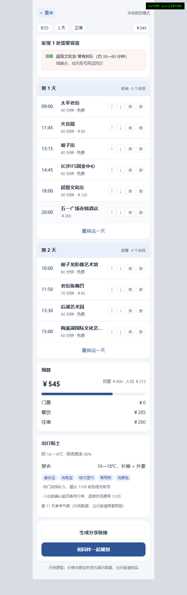
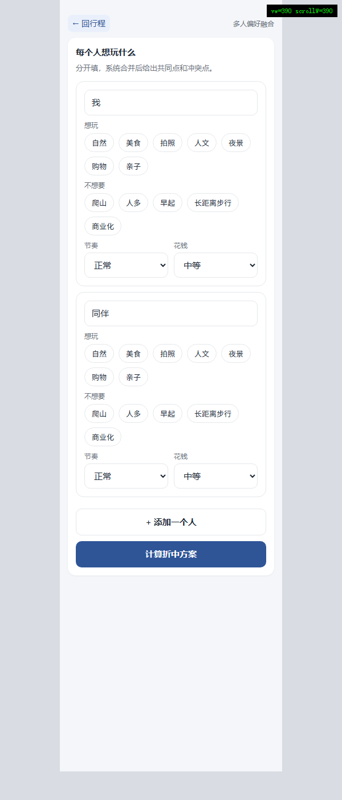

# 闲行智策 · 代码仓库

> **主线应用在 [`phase1/`](phase1/)，根目录 `legacy/` 是早期版本（v0.1，接口不同），仅作存档，不要启动。**
>
> 线上演示：<https://xianxing-zhice.onrender.com>（Render 从本仓库 `phase1/` 构建）

## 目录

| 路径 | 说明 |
|---|---|
| `phase1/` | **可运行的应用**：FastAPI + 5 个页面 + 5 个智能体模块，严格按接口文档输出 |
| `phase1/README.md` | 怎么跑、怎么自检、功能对照 |
| `phase1/docs/接口实现说明.md` | 回答产品侧字段问题、降级方案、错误码 |
| `render.yaml` | Render 部署配置（`rootDir: phase1`） |
| `DEPLOY_双仓.md` | GitHub / Gitee 双仓使用方法 |
| `项目总结与部署说明.md` | 项目总结（早期版本期写的，结构部分已过时） |
| `legacy/` | 早期 v0.1（含结伴），仅存档 |

## 快速开始

```powershell
cd phase1
..\.venv\Scripts\python.exe -m uvicorn server.main:app --host 0.0.0.0 --port 8002
```

打开 <http://127.0.0.1:8002>，接口文档 <http://127.0.0.1:8002/docs>。

自检（按 `docs/接口数据字段说明.md` 逐条断言）：

```powershell
..\.venv\Scripts\python.exe scripts\check_spec.py
```

## 能力一览

- **5 个页面**：P1 需求输入 / P2 行程浏览与编辑 / P3 预算清单 / P4 出行贴士 / P5 已保存行程
- **双端**：手机单栏（底部浮条）、电脑三栏（左天列表 + 中条目 + 右预算/校验/候选）
- **8 个城市**：北京、上海、广州、重庆、成都、西安、长沙、杭州（119 条景点/餐饮/住宿）
- **模型可选**：配 `LLM_API_KEY` 用模型做需求解析与贴士文案，没配自动退回规则
- **联网可选**：配 `AMAP_KEY` 可按城市拉高德 POI
- **错误处理**：预算不足给建议（TC-04）、不认识的地名不编造（TC-05）、模糊需求反问（TC-06）

---

# 早期版本存档（legacy/）

第一阶段的可运行雏形，含结伴模式，接口与现在完全不同（`/api/parse`、`/api/trips`、`/swap`、`/regenerate`）。
仅作历史记录，**不要用来演示**：在新版页面上点“生成”会 404，因为接口不存在。

| 首页 | 行程页 | 结伴页 |
|---|---|---|
|  |  |  |
